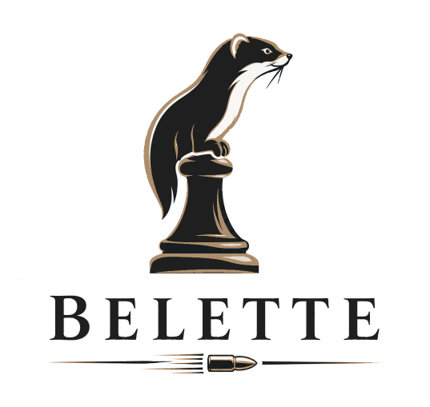

<p align="center"></p>

# Belette
Another UCI-compatible chess engine written in C++. 

For now it only supports CPUs with AVX2 and BMI2 instructions. Support for other architectures might be added in the future.

See [Release page](https://github.com/vincentbab/Belette/releases) for precompiled binaries

You can play against the engine on lichess: https://lichess.org/@/Belette-Bot
<br>
The Bot will only accept one challenge at a time.

## Compiling

Tested on Windows and Linux with GCC >= 12 and CLang >= 19

```sh
make
```
Executable will be in `./build/Release/bin/belette[.exe]`

## UCI Options

### Debug Log File
Log every input and output of the engine to the specified file

### Hash
Specify the hash table size in megabytes

### Clear Hash
Clear the hash table and all history tables

### Threads
For now this option doesn't do anything. It's only for compatibility purpose

### Move Overhead
Time in milliseconds subtracted from the remaining time and from movetime to compensate for communication delays (default 10ms)

### UCI_Chess960
Use the Chess960 castling notation (king takes own rook) for moves.

## Internals

### Board & Move generation
 - Bitboard
 - Zobrist hashing
 - Fast legal move enumeration inspired by [Gigantua](https://github.com/Gigantua/Gigantua)
```
perft 7, start position, Core i7 12700k

Nodes: 3195901860
NPS: 925007774
Time: 3455ms
```

### Search
 - Iterative deepening
 - Aspiration window
 - Negamax
 - Transpositation Table
 - Check extension
 - Null move pruning (NMP), with dynamic reduction
 - Reverse futility pruning (RFP)
 - Futility pruning (fail-soft)
 - History pruning
 - ProbCut
 - Singular extensions (including double and triple extensions)
 - Internal iterative reduction (IIR)
 - Late move reduction (LMR)
 - Late move pruning (LMP)
 - Improving heuristic
 - SEE pruning
 - Quiescence

 ### Move ordering
  - Hash move (TT Move)
  - MVV-LVA
  - Killer moves
  - Counter move
  - Threats
  - Checks
  - Butterfly history (threat-indexed)
  - Pawn history
  - Continuation history
  - Capture history
  - Correction history (pawn, non-pawn, major, minor, continuation)
  - Staged move generation (good captures, good quiets, bad captures, bad quiets), with lazy selection of quiet moves

### Evaluation
 - Tapered
 - Material
 - PSQT ([PeSTO](https://www.chessprogramming.org/PeSTO%27s_Evaluation_Function))

### Time management
 - Soft and hard time limits
 - Scaling from best move stability, best move effort and score trend

### Tuning
 - Search parameters tuned with SPSA
 - Evaluation tuned with Texel's method on lichess-big3-resolved

## Credits

Resources and other engines that inspired me:
 - People at the Stockfish Discord
 - [Chess Programming Wiki](https://www.chessprogramming.org/)
 - [Gigantua](https://github.com/Gigantua/Gigantua)
 - [OpenBench](https://github.com/andygrant/openbench)
 - [Stockfish](https://stockfishchess.org/)
 - [Ethereal](https://github.com/AndyGrant/Ethereal)
 - [Stormphrax](https://github.com/Ciekce/Stormphrax)
 - [Potential](https://github.com/ProgramciDusunur/Potential)
 
